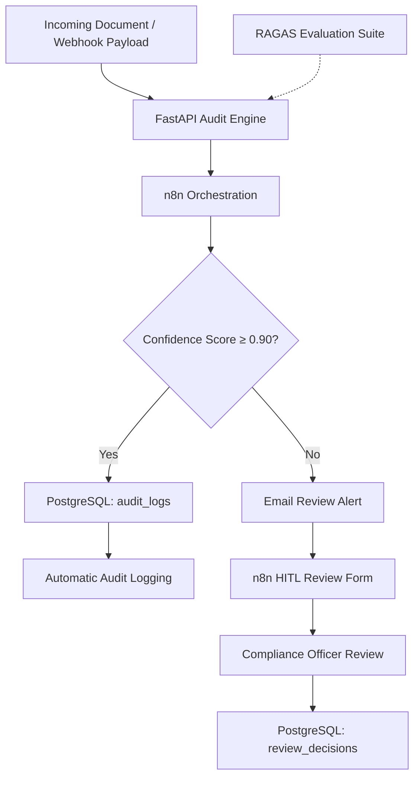

# 🛡️ AuditGuard AI

### An Enterprise-Grade Autonomous Compliance & Risk Audit Pipeline

**AuditGuard AI** is an automated compliance auditing system designed to ingest, evaluate, and route regulatory documents and vendor contracts through intelligent, confidence-based workflows.

Built with **FastAPI, n8n, PostgreSQL, and Docker**, the system automatically processes audit evaluations and routes low-confidence results to a non-blocking Human-in-the-Loop (HITL) review workflow. All automated assessments and human review decisions are persisted for traceability, accountability, and compliance reporting.

The project also integrates **RAGAS benchmarking** to evaluate the quality and reliability of retrieval-augmented generation (RAG) outputs.

---

## 📐 Architecture Overview



### Workflow Summary

1. **Document Ingestion:** Incoming documents or webhook payloads are submitted to the FastAPI audit service.
2. **Automated Evaluation:** The backend evaluates the document and produces an audit result with an associated confidence score.
3. **Confidence-Based Routing:** n8n evaluates the confidence score against a configurable threshold of `0.90`.
4. **Automatic Logging:** Results meeting the confidence threshold are recorded in the `audit_logs` table.
5. **Human Review:** Results below the threshold trigger an email notification and a separate n8n form workflow for compliance officer review.
6. **Decision Persistence:** Human decisions, notes, and overrides are stored in the `review_decisions` table.
7. **Quality Benchmarking:** The RAGAS evaluation suite measures the quality of generated audit responses.

---

## ✨ Key Features

- **Automated Compliance Auditing:** Document ingestion and heuristic audit analysis through a FastAPI microservice.
- **Confidence-Based Decision Routing:** Automatically branches audit results using a configurable confidence threshold.
- **Human-in-the-Loop (HITL) Review:** Routes uncertain assessments to compliance officers through email-triggered review forms.
- **Decoupled Review Workflow:** Separates human review from the primary audit execution path, allowing the main workflow to continue without waiting for a reviewer.
- **Persistent Audit Trail:** PostgreSQL records automated assessments and human review decisions for traceability.
- **Structured Review Decisions:** Supports `APPROVE`, `REJECT`, and `NEEDS_MODIFICATION` actions with reviewer notes.
- **RAGAS Benchmarking:** Evaluates faithfulness, answer relevancy, and context precision.
- **Containerized Infrastructure:** Uses Docker to run PostgreSQL in an isolated, reproducible environment.

---

## 🛠️ Tech Stack

| Component | Technologies |
|---|---|
| Backend API | FastAPI, Python 3.10+, Uvicorn |
| Workflow Orchestration | n8n, Webhooks, IF Nodes, Email Nodes, Forms |
| Database | PostgreSQL, SQL |
| Infrastructure | Docker, Docker Desktop |
| Evaluation | RAGAS, Hugging Face Datasets, Pandas |
| Development Tools | Git, GitHub, Virtual Environments |

---

## 🗄️ Database Schema

The system uses a PostgreSQL database named `auditguard`, hosted in a Docker container named `auditguard-postgres`.

### 1. `audit_logs`

Stores automated audit assessments that meet the confidence threshold.

| Column | Data Type | Description |
|---|---|---|
| `id` | `SERIAL PRIMARY KEY` | Unique record identifier |
| `filename` | `VARCHAR(255)` | Name of the audited document |
| `overall_confidence` | `FLOAT` | Overall audit confidence score |
| `status` | `VARCHAR(50)` | Automated audit status, such as `AUTO_APPROVED` |
| `created_at` | `TIMESTAMP` | Timestamp of record creation |

### 2. `review_decisions`

Stores compliance officer decisions for documents flagged for human review.

| Column | Data Type | Description |
|---|---|---|
| `id` | `SERIAL PRIMARY KEY` | Unique record identifier |
| `filename` | `VARCHAR(255)` | Name of the reviewed document |
| `reviewer_action` | `VARCHAR(50)` | Decision: `APPROVE`, `REJECT`, or `NEEDS_MODIFICATION` |
| `notes` | `TEXT` | Reviewer comments or justification |
| `reviewed_at` | `TIMESTAMP` | Timestamp of review submission |

---

## 🚀 Getting Started

### Prerequisites

Ensure the following are installed and available:

- [Docker Desktop](https://www.docker.com/products/docker-desktop/)
- Python 3.10 or later
- [n8n](https://n8n.io/) running locally or through Docker
- Git

### 1. Clone the Repository

```bash
git clone <your-repository-url>
cd auditguard-ai
```

Replace `<your-repository-url>` with your GitHub repository URL.

### 2. Set Up PostgreSQL

Start the PostgreSQL container:

```bash
docker run --name auditguard-postgres \
  -e POSTGRES_USER=postgres \
  -e POSTGRES_PASSWORD=postgres \
  -e POSTGRES_DB=auditguard \
  -p 5432:5432 \
  -d postgres:latest
```

Initialize the database tables:

```bash
docker exec -i auditguard-postgres \
  psql -U postgres -d auditguard <<'SQL'
CREATE TABLE IF NOT EXISTS audit_logs (
    id SERIAL PRIMARY KEY,
    filename VARCHAR(255) NOT NULL,
    overall_confidence FLOAT NOT NULL,
    status VARCHAR(50) NOT NULL,
    created_at TIMESTAMP DEFAULT CURRENT_TIMESTAMP
);

CREATE TABLE IF NOT EXISTS review_decisions (
    id SERIAL PRIMARY KEY,
    filename VARCHAR(255) NOT NULL,
    reviewer_action VARCHAR(50) NOT NULL,
    notes TEXT,
    reviewed_at TIMESTAMP DEFAULT CURRENT_TIMESTAMP
);
SQL
```

Verify that the tables were created:

```bash
docker exec -it auditguard-postgres \
  psql -U postgres -d auditguard \
  -c "\dt"
```

**Database configuration**

| Setting | Value |
|---|---|
| Container | `auditguard-postgres` |
| Database | `auditguard` |
| Username | `postgres` |
| Port | `5432` |

> **Note:** The credentials above are for local development only. Use environment variables and secure credentials for production deployments.

### 3. Set Up the FastAPI Backend

Create and activate a virtual environment.

**Windows — PowerShell**

```powershell
python -m venv .venv
.\.venv\Scripts\Activate.ps1
```

**Linux / macOS / WSL**

```bash
python3 -m venv .venv
source .venv/bin/activate
```

Install the backend dependencies:

```bash
pip install fastapi uvicorn pydantic
```

Start the FastAPI application from the project root:

```bash
uvicorn backend.main:app --reload
```

The API should be available at:

- **API base URL:** http://127.0.0.1:8000
- **Interactive API documentation:** http://127.0.0.1:8000/docs
- **Alternative API documentation:** http://127.0.0.1:8000/redoc

These URLs assume the application uses Uvicorn's default port and exposes the corresponding FastAPI documentation routes.

### 4. Configure n8n Workflows

Open your n8n instance at http://localhost:5678.

Import the workflow files:

1. `workflows/01_Compliance_Audit_Pipeline.json`
2. `workflows/02_Compliance_Review_Handler.json`

Configure the required credentials and workflow connections.

**PostgreSQL node configuration**

| Setting | Value |
|---|---|
| Host | `127.0.0.1` or `host.docker.internal`, depending on the deployment |
| Port | `5432` |
| Database | `auditguard` |
| User | `postgres` |
| Password | Your configured PostgreSQL password |

**Important:** If n8n runs inside Docker while PostgreSQL runs on the host, `host.docker.internal` may be appropriate. If both services run in Docker, use the PostgreSQL service or container name on a shared Docker network. `127.0.0.1` inside the n8n container refers to the n8n container itself, not the host or another container.

Before activating the workflows:

- Verify the webhook URL and FastAPI endpoint.
- Configure PostgreSQL credentials.
- Configure the email provider and recipient.
- Verify the confidence threshold in the IF node.
- Confirm that the review form submits to the correct logging workflow.
- Test both automatic and human-review branches.

Activate the workflows once the configuration is complete.

---

## 📊 RAGAS Evaluation

AuditGuard AI includes a benchmarking environment for evaluating the quality of generated compliance assessments.

The evaluation script is located at:

```text
evals/eval_pipeline.py
```

### Evaluation Metrics

| Metric | Purpose |
|---|---|
| Faithfulness | Measures whether generated claims are supported by the retrieved context |
| Context Precision | Evaluates the relevance and ranking of retrieved context |
| Answer Relevancy | Measures how directly a generated response addresses the audit query |

### Run the Evaluation Suite

Navigate to the evaluation directory:

```bash
cd evals
```

Install the evaluation dependencies:

```bash
pip install -r requirements-eval.txt
```

Execute the benchmark:

```bash
python eval_pipeline.py
```

The evaluation results can be used to identify weaknesses in retrieval quality, contextual grounding, and generated audit responses.

> **Note:** Actual metric values depend on the evaluation dataset, model configuration, and RAGAS version. The evaluation script must supply the appropriate inputs and configuration for the selected metrics.

---

## 📂 Repository Structure

```text
auditguard-ai/
├── backend/
│   └── main.py
│
├── evals/
│   ├── eval_pipeline.py
│   └── requirements-eval.txt
│
├── workflows/
│   ├── 01_Compliance_Audit_Pipeline.json
│   └── 02_Compliance_Review_Handler.json
│
├── .gitignore
└── README.md
```

| Path | Description |
|---|---|
| `backend/main.py` | FastAPI compliance audit service |
| `evals/eval_pipeline.py` | RAGAS benchmarking script |
| `evals/requirements-eval.txt` | Evaluation dependencies |
| `workflows/01_Compliance_Audit_Pipeline.json` | Main ingestion, evaluation, and branching workflow |
| `workflows/02_Compliance_Review_Handler.json` | Human review form and decision logging workflow |
| `.gitignore` | Excludes local configuration, environments, and generated files |
| `README.md` | Project documentation and setup instructions |

---

## 🔄 Decision Logic

The system uses a configurable confidence threshold to determine the next action.

```python
CONFIDENCE_THRESHOLD = 0.90

if overall_confidence >= CONFIDENCE_THRESHOLD:
    status = "AUTO_APPROVED"
else:
    status = "REQUIRES_HUMAN_REVIEW"
```

| Condition | Action | Destination |
|---|---|---|
| Confidence ≥ 0.90 | Automatic approval branch | `audit_logs` |
| Confidence < 0.90 | Trigger human review | `review_decisions`, after submission |

**Important:** A confidence score is not proof of regulatory compliance. The threshold should be calibrated against representative validation data, and critical or high-impact compliance decisions may require mandatory human approval regardless of the score.

---

## 🔐 Reliability and Security Considerations

For production-oriented deployments, consider implementing the following:

- **Credential management:** Store database credentials and API keys in environment variables or a secrets manager.
- **Input validation:** Validate document metadata, payload structure, and confidence score ranges.
- **Audit traceability:** Record document identifiers, evaluation timestamps, rule versions, and review outcomes.
- **Error handling:** Add retries, timeouts, and failure logging for API, database, and email operations.
- **Workflow resilience:** Use independent review workflows, persistent execution records, and idempotent operations to reduce duplicate processing.
- **Access control:** Restrict access to review forms and protect sensitive contractual information.
- **Data protection:** Apply appropriate retention policies, encryption, and access controls to audit records.
- **Decision governance:** Clearly distinguish model-generated recommendations from authorized human compliance decisions.

---

## 🗺️ Future Enhancements

Potential extensions include:

- RAG-based retrieval of regulatory clauses and compliance policies.
- Automated clause extraction and rule-based risk classification.
- Risk severity scoring alongside extraction confidence.
- Reviewer dashboards for pending reviews and decision history.
- Versioned compliance rules and document-level traceability.
- Automated regression tests for audit workflows.
- Expanded evaluation datasets and benchmark reporting.
- Docker Compose orchestration for the API, database, and supporting services.

---

## 🎯 Project Objective

AuditGuard AI demonstrates how backend services, workflow automation, relational persistence, and evaluation frameworks can be combined to create a traceable compliance review system.

By separating automated assessments from human review, the architecture supports structured decision routing, operational accountability, and measurable evaluation of AI-generated outputs.

---

## 📄 License

Add a `LICENSE` file to specify the terms under which this project may be used, modified, and distributed.
